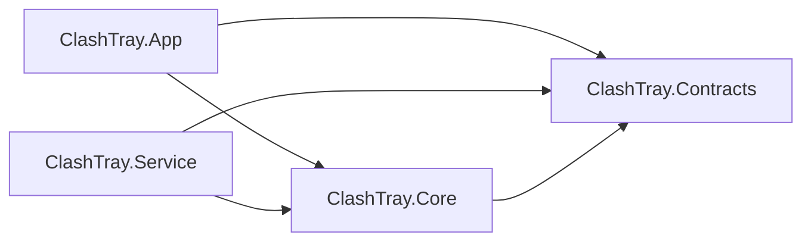

# ClashTray 代码结构优化报告（2026-10-10）

本次审查的结论是：现有 App / Core / Service / Contracts 分层可以继续使用，下一阶段应围绕现有行为做小步重构。最有价值的工作是统一两条启动路径的确认策略、拆分服务控制类，以及继续收敛 Runtime 的职责。功能扩展、技术栈替换和大规模重写不属于本报告的建议。

审查基线为 `f015e16`，仓库版本为 `0.3.5`。检查对象包括生产源码、项目引用、测试组织、CI 和当前架构说明；已对照 2026-10-02 的设计优化与后续修复记录。以下发现是代码结构与维护成本判断，不能直接等同于已复现的用户故障。

## 1. 工程现状

项目引用方向符合现有分层：App 和 Service 引用 Core / Contracts，Core 只引用 Contracts，Contracts 没有项目依赖。未发现 Core 反向引用 WinUI App 或 Service 的项目循环。



下表统计源码 `.cs` 文件，包括空行与注释，排除 `bin` / `obj`，不含 XAML。App 数字包含仅 Debug 编译的 SmokeTest；Core 数字包含目前仍随 Core 编译的 TestHooks。行数用于定位检查重点，不作为单独的质量标准。

| 项目 | C# 文件数 | 行数 | 观察 |
| --- | ---: | ---: | --- |
| ClashTray.App | 22 | 6,815 | 窗口、设置页与命令编排较集中 |
| ClashTray.Core | 118 | 28,373 | 117 个文件位于项目根目录，主要使用同一个命名空间 |
| ClashTray.Service | 9 | 3,349 | 超过一半源码集中在 ServiceRuntimeController |
| ClashTray.Contracts | 3 | 598 | 状态模型、设置模型和 IPC 协议共处于少数文件 |
| ClashTray.Core.Tests | 103 | 22,393 | 覆盖面较广，包含应用逻辑、文件和进程边界测试 |
| ClashTray.IntegrationTests | 14 | 3,449 | 包含隔离服务测试及需要真实环境能力的测试 |
| ClashTray.PerformanceHarness | 3 | 327 | 已有独立性能测量入口 |

需要重点关注的结构集中点：

| 对象 | 规模 | 结构上的含义 |
| --- | ---: | --- |
| ClashTrayRuntime 的 9 个 partial 文件 | 5,284 行；扣除 TestHooks 后 5,141 行 | 文件已拆开，类的共享状态与职责仍较多 |
| ClashTrayRuntime.Lifecycle.cs | 1,748 行 | 初始化、启动事务、停止、健康确认、轮询和服务接管集中 |
| ServiceRuntimeController.cs | 1,704 行 | 请求恢复、命令调度、核心生命周期、更新和 TUN 状态共用一个类 |
| SettingsPage.xaml.cs | 1,326 行 | 设置草稿、端点编辑、网络规则、维护动作与展示集中 |
| MainWindow.xaml.cs | 1,047 行 | 窗口模式、页面更新、配置命令和状态展示集中 |
| OperationAdmission.cs | 1,174 行 | 同一文件包含门禁、清理执行器及多种请求合并策略；优先拆文件即可 |

## 2. 已有设计中应保留的部分

以下基础已经存在，后续重构应在它们之上进行：

- 明确的 Core / System Proxy / TUN / Subscription 状态模型，以及真实 OS / 核心状态确认。
- `RuntimeStateStore` 的同步状态提交、revision 和条件提交；核心与控制器的代际防护。
- 设置恢复 journal、配置切换 journal、网络关闭意图及外部代理所有权保护。
- 服务协议 3 的 RequestId 去重、请求指纹、RecoveryOnly、服务实例身份和独立清理配额。
- 共享 YAML 结构识别、有界输入、日志保留与重复折叠、列表稳定更新、按页面需求刷新。
- `SettingsEditModel` 和 `PageCommandRunner` 的草稿及页面生命周期语义。
- 中央依赖版本管理、nullable、分析器和警告作为错误的构建约束。

2026-10-02 的优化已经提取 `CoreLifecycleCoordinator`、设置编辑模型、生产/隔离工厂等边界。本报告建议继续完善这些边界，不把上述已完成内容列成待实现能力。

## 3. 优化建议与优先级

本报告的“高 / 中 / 低”表示重构顺序和预期维护收益，不对应产品功能的 P0 / P1，也不是漏洞严重性分级。工作量为基于当前代码的粗略判断，尚未执行重构验证。

| 编号 | 建议 | 优先级 | 预期收益 | 工作量 / 回归风险 |
| --- | --- | --- | --- | --- |
| S1 | 统一本地与服务启动的就绪确认策略 | 高 | 减少安全及失败策略的双份维护 | 中 / 高 |
| S2 | 拆分 ServiceRuntimeController 的请求台账与业务执行 | 高 | 缩小服务修复的影响范围 | 中 / 中至高 |
| S3 | 进一步收敛 Runtime 的事务与状态归属 | 高 | 减少共享字段和回调依赖 | 大；分片执行 / 高 |
| S4 | 按职责拆分设置页及窗口展示逻辑 | 中 | 提高 UI 修改与测试的可控性 | 中 / 中 |
| S5 | 显式化测试组装，收缩生产测试入口 | 中 | 避免构造方式隐式改变环境语义 | 中 / 中 |
| S6 | 收敛快照投影和 Controller 数据读取边界 | 中 | 减少状态含义和失败保留策略的重复维护 | 中 / 中至高 |
| S7 | 按模块整理目录、契约及内部访问边界 | 中；可先做低风险部分 | 降低查找和跨模块误用成本 | 小至中 / 低至中 |
| S8 | 固定构建工具链，更新当前文档入口 | 低；可顺手完成 | 提高重现性与交接准确性 | 小 / 低 |

### S1：统一启动就绪确认策略

**证据。** [本地 WaitForLocalRuntimeBindingAsync](https://github.com/arukas/ClashTray/blob/f015e164190bf6eb682c2aa3952204deb1f66b49/src/ClashTray.Core/ClashTrayRuntime.Lifecycle.cs#L785) 和 [服务 WaitForReadyBindingAsync](https://github.com/arukas/ClashTray/blob/f015e164190bf6eb682c2aa3952204deb1f66b49/src/ClashTray.Service/ServiceRuntimeController.cs#L855) 分别维护约 160 行的相近流程：进程身份检查、控制器所有权检查、读取 `/configs`、核对代理端口、确认初始 TUN Off、确认各监听、生成运行绑定，以及重试和期限诊断。连运行监听记录的构造也各有一份。

已经共享 `ListenerReadinessEvaluator`、`ListenerReadinessDeadline` 和 `RuntimeBindingValidator`，但共享范围仍偏底层，两条完整流程继续独立演进。

**影响。** 后续调整监听确认、取消分类或失败诊断时，需要同时理解并修改两条路径。即使当前行为通过测试，也存在修复覆盖不一致的维护风险。

**建议。** 在 Core 内提取一个限定用途的启动确认组件，统一配置核对、监听判定、绑定构造和期限结果。两端分别提供自己持有的进程身份、API 会话和真实观察证据，并在边界处映射各自的错误类型。服务继续独立验证允许的路径、载荷和当前进程所有权。

**验收。** 同一组语义场景分别覆盖本地与服务执行器：控制器抢占、监听缺失 / Unknown / Foreign、API 延迟、进程退出、取消与超时。保留实际端口、代际、TUN 初始 Off 和完整监听证据。结构共享不能使服务把桌面传入的身份声明当作可信事实。

### S2：拆分服务的请求台账与业务执行

**证据。** [ServiceRuntimeController](https://github.com/arukas/ClashTray/blob/f015e164190bf6eb682c2aa3952204deb1f66b49/src/ClashTray.Service/ServiceRuntimeController.cs#L18) 同时拥有请求缓存、TTL、配额、指纹、后台执行、核心进程、API 客户端、更新器和 TUN 状态。请求台账从 [HandleWithRequestCacheAsync](https://github.com/arukas/ClashTray/blob/f015e164190bf6eb682c2aa3952204deb1f66b49/src/ClashTray.Service/ServiceRuntimeController.cs#L130) 开始，业务调度从 [HandleCoreAsync](https://github.com/arukas/ClashTray/blob/f015e164190bf6eb682c2aa3952204deb1f66b49/src/ClashTray.Service/ServiceRuntimeController.cs#L304) 开始，启动、核心更新和 TUN 处理继续留在同一个类中。

**影响。** 一个 RequestId 或清理配额修复会触及拥有真实进程和网络操作的控制类，难以单独审查、测试和说明资源生命周期。

**建议。** 第一片仅提取有界请求台账，负责请求指纹、加入已有执行、完成结果、过期和配额。后续再按需要提取核心更新处理及生命周期执行。保留一个明确的服务调度入口和统一的副作用串行化策略。现有 `TunTransactionCoordinator` 已有独立职责，可继续复用。

清理请求分类仍必须依赖服务确认的当前目标；台账不能凭客户端提供的标记认定请求具有清理资格。提取过程保持协议 3 和现有允许的命令集合。

**验收。** 复用现有请求身份与清理准入测试，覆盖相同 ID 合并、不同载荷拒绝、RecoveryOnly 不重放、服务实例变化、完成结果 TTL、观察 / 普通变更 / 清理配额，以及清理排队期限。第一片可以用可控任务和时间源单独验证台账，无需启动真实服务。

### S3：进一步收敛 Runtime 的事务与状态归属

**证据。** `ClashTrayRuntime` 的 9 个 partial 文件仍共享大量字段。[构造与组装](https://github.com/arukas/ClashTray/blob/f015e164190bf6eb682c2aa3952204deb1f66b49/src/ClashTray.Core/ClashTrayRuntime.cs#L95) 包含兼容构造参数、存储、会话、生命周期、刷新和多个回调连接；[ProxyOperationCoordinator 构造](https://github.com/arukas/ClashTray/blob/f015e164190bf6eb682c2aa3952204deb1f66b49/src/ClashTray.Core/ProxyOperationCoordinator.cs#L62) 也依赖多个其他 Coordinator、状态存储及委托。

已经提取的 [CoreLifecycleCoordinator](https://github.com/arukas/ClashTray/blob/f015e164190bf6eb682c2aa3952204deb1f66b49/src/ClashTray.Core/CoreLifecycleCoordinator.cs#L66) 持有进程、binding、epoch 和健康印记，但完整 [启动事务](https://github.com/arukas/ClashTray/blob/f015e164190bf6eb682c2aa3952204deb1f66b49/src/ClashTray.Core/ClashTrayRuntime.Lifecycle.cs#L366)、服务接管及轮询仍由 Runtime 编排。配置切换的 [RuntimeConfigurationSwitchOperations](https://github.com/arukas/ClashTray/blob/f015e164190bf6eb682c2aa3952204deb1f66b49/src/ClashTray.Core/ClashTrayRuntime.Configuration.cs#L373) 持有整个 Runtime，访问其私有状态，并通过可变 `ActiveLease` 传递当前操作锁。退出过程的 [DisposeCoreAsync](https://github.com/arukas/ClashTray/blob/f015e164190bf6eb682c2aa3952204deb1f66b49/src/ClashTray.Core/ClashTrayRuntime.Shutdown.cs#L23) 仍是很长的完整流程。

**影响。** 单个业务动作需要知道多个 Coordinator 的内部时序，文件拆分没有完全降低共享状态和资源所有权的复杂度。修改设置、配置、生命周期或退出路径时，仍需要阅读多个 partial 文件。

**建议。** 先完成 S1 / S2，再按具体事务逐片提取：

1. 让生命周期组件逐步拥有完整启动、停止和接管事务，Runtime 保留对外用例入口与结果发布。
2. 将设置恢复、字段合并、journal 和持久提交收敛到一个设置提交组件，沿用现有恢复策略。
3. 把配置切换的当前 lease / 绑定 / 代际以每次操作的明确参数传递，减少持有整个 Runtime 的适配器。
4. 最后处理退出编排，把清理计划、执行和资源保留分别表达清楚。

新增边界应对应独立生命周期或可单测的策略。可先把组装移入现有工厂；当前规模下，无需为重构额外引入 DI 容器、消息总线或通用事务框架。

**验收。** 保留 OperationGate 准入与串行化、代际失效、实际绑定确认、未知服务结果恢复、设置同字段冲突保护，以及网络关闭优先于存储恢复的顺序。退出超时后仍在运行的任务必须继续持有其资源与清理所有权，不能因缩短方法提前释放。每片以既有行为回归和故障注入证明等价。

### S4：拆分设置页与窗口展示逻辑

**证据。** [SettingsPage](https://github.com/arukas/ClashTray/blob/f015e164190bf6eb682c2aa3952204deb1f66b49/src/ClashTray.App/SettingsPage.xaml.cs#L11) 同时处理普通设置草稿、网络开关、远程端点编辑、网络规则、Provider 与核心维护。`SettingsEditModel` 和 `SettingsPageCommands` 已提取，但大量控件同步、表单验证和动态行构造仍在 code-behind 中。

[普通设置保存](https://github.com/arukas/ClashTray/blob/f015e164190bf6eb682c2aa3952204deb1f66b49/src/ClashTray.App/SettingsPage.xaml.cs#L546) 已使用 `PageCommandRunner` 与 `CanPresent`；[网络规则保存 / 恢复入口](https://github.com/arukas/ClashTray/blob/f015e164190bf6eb682c2aa3952204deb1f66b49/src/ClashTray.App/SettingsPage.xaml.cs#L436) 仍维护独立 busy 字段并直接调用 Runtime。相关网络规则区域当前为 Collapsed，本报告只评估已有源码，不建议启用它。

[MainWindow](https://github.com/arukas/ClashTray/blob/f015e164190bf6eb682c2aa3952204deb1f66b49/src/ClashTray.App/MainWindow.xaml.cs#L187) 也同时承担窗口模式、状态投影、页面刷新、配置命令和图表展示。

**影响。** 页面修改容易同时影响草稿、命令准入与展示时序；组件逻辑的测试边界仍不完整。单纯继续拆成 partial 文件不会解决这些职责之间的连接。

**建议。** 保持现有页面布局，按普通设置、端点编辑、网络控制及维护区域提取展示模型或小型 UserControl。页面保留控件事件和 WinUI 特有的对话框、选择器、焦点处理；可独立测试的草稿、验证、命令结果和行模型放到明确边界。逐步统一已经存在的页面生命周期结果展示策略。窗口先提取状态格式化 / 展示投影，原生窗口模式另保持独立。

**验收。** 保存过程中继续编辑、非法数字文本、外部设置变化、离开页面后命令完成、端点切换及代际失效都维持现有语义。需要实际 WinUI 验证焦点、键盘、DPI 与高对比度；普通模型测试不能替代控件验收。

### S5：显式化测试组装，收缩生产测试入口

**证据。** [Core.Tests 项目](D:/ClashTray/tests/ClashTray.Core.Tests/ClashTray.Core.Tests.csproj:9) 通过 `Compile Include` 链接编译 7 个 App 源文件，其中包含原生互操作和页面命令逻辑。这是目前绕开 WinUI 依赖的实用方式，但测试的是在测试程序集内重新编译的代码，不能证明 App 的完整组装、条件编译和页面接线正确。

[ClashTrayRuntime.TestHooks.cs](https://github.com/arukas/ClashTray/blob/f015e164190bf6eb682c2aa3952204deb1f66b49/src/ClashTray.Core/ClashTrayRuntime.TestHooks.cs#L10) 的 fixture 观察源总是返回进程当前 / 监听 Owned；这些类型和内部状态注入方法仍随 Core 编译。[兼容组装](https://github.com/arukas/ClashTray/blob/f015e164190bf6eb682c2aa3952204deb1f66b49/src/ClashTray.Core/RuntimeEnvironmentDependencies.cs#L14) 依赖 `paths` 是否为 null 来选择真实或替身启动 / 服务行为，而 System Proxy 默认仍是 `SystemProxyManager`。当前 App 已使用明确的 Production / Isolated 工厂；问题主要留在兼容入口和测试组织。

**影响。** 维护者必须记住构造入口的隐含语义。测试专用观察行为与生产观察能力共处于一个程序集，增加了误组装和误解测试证明范围的可能性。这是可维护性问题，本次没有据此认定可利用的安全漏洞。

**建议。** 新测试统一使用明确的 fixture builder，显式指定路径、服务、代理、观察证据和时间源；迁移旧兼容构造使用后，再收缩该入口。fixture 观察源逐步移动到测试侧，经已有窄观察接口注入；减少直接写入 Runtime 内部状态的 hook。

对 App 源文件链接，先把纯展示 / 命令逻辑集中组织并维护明确清单。随着 S4 提取形成稳定边界，可考虑一个很小的可直接引用的展示逻辑程序集；只有存在明确测试收益时才新增项目。保留 Debug WinUI smoke，对实际 App 组装做验证。

**验收。** 核对 Release 构建中的 fixture 类型和测试入口；逻辑测试继续执行生产准入 / 代际判定。真实所有权确认、ACL、TLS、正式服务和 UI 接线各由相应边界测试证明，报告区分这些证据。

### S6：收敛快照投影和 Controller 数据读取

**证据。** 运行时同时公开 `RuntimeSnapshot` 和 `AppSnapshot`。当前 [App 收到 AppSnapshot 后](https://github.com/arukas/ClashTray/blob/f015e164190bf6eb682c2aa3952204deb1f66b49/src/ClashTray.App/App.xaml.cs#L481) 为托盘再次转换成 RuntimeSnapshot；[MainWindow](https://github.com/arukas/ClashTray/blob/f015e164190bf6eb682c2aa3952204deb1f66b49/src/ClashTray.App/MainWindow.xaml.cs#L187) 保存控制器相关字段后，再转换为 RuntimeSnapshot 交给页面更新。

本地数据读取由 [RuntimeDataRefreshCoordinator](https://github.com/arukas/ClashTray/blob/f015e164190bf6eb682c2aa3952204deb1f66b49/src/ClashTray.Core/RuntimeDataRefreshCoordinator.cs#L87) 实现，远程读取通过 [MihomoControllerSnapshotReader](https://github.com/arukas/ClashTray/blob/f015e164190bf6eb682c2aa3952204deb1f66b49/src/ClashTray.Core/MihomoControllerSnapshotReader.cs#L42) 实现。两处都有代理、指标、连接、规则和 Provider 的可选读取及旧数据保留逻辑。另一个需要明确的边界是 [Snapshot getter](https://github.com/arukas/ClashTray/blob/f015e164190bf6eb682c2aa3952204deb1f66b49/src/ClashTray.Core/ClashTrayRuntime.cs#L267) 会调用日志 flush，使读取同时可能触发状态提交。

**影响。** 同一状态经过多次投影，页面需要额外字段才能恢复它所属的本机 / 选中控制器语义。两个读取入口需要同步维护资源失败后的保留规则；快照读取的副作用也增加了理解 revision 的成本。本次没有做分配或 UI 帧率测量，不能据此量化性能收益。

**建议。** 保留本机设备与当前控制器的语义分离。逐步让页面接收 `AppSnapshot` 中对应的明确上下文，将旧适配器限制到兼容边界。提取共用的只读资源采集 / 结果模型，控制器所有权、代际检查、重连与状态提交仍由各自会话负责。日志 flush 放在明确的批处理 / 发布阶段，使快照读取更接近纯读取。

**验收。** 远程核心状态变化不得改变本机代理 / TUN 含义；旧控制器结果不得提交给新会话；可选资源失败保留已经确认的数据。保留页面需求刷新、日志节流、列表上限和 reference 稳定语义。任何性能收益必须由现有 PerformanceHarness 或明确 UI 测量验证。

### S7：整理模块目录、契约与内部访问边界

**证据。** Core 的 117 个源码文件位于根目录；[StateContracts.cs](https://github.com/arukas/ClashTray/blob/f015e164190bf6eb682c2aa3952204deb1f66b49/src/ClashTray.Contracts/StateContracts.cs#L3) 同时包含状态、UI 数据模型、设置和 IPC 请求 / 响应。[Core AssemblyInfo](https://github.com/arukas/ClashTray/blob/f015e164190bf6eb682c2aa3952204deb1f66b49/src/ClashTray.Core/Properties/AssemblyInfo.cs#L5) 将整个程序集的 internal 对 Service 开放。

**影响。** 当前项目引用方向正确，但项目内部边界主要依靠类名和维护者约定。查找某个事务的数据来源、判断哪些 Core 类型允许被服务依赖，需要较多人工上下文。

**建议。** 先在现有项目内分目录，不同时进行全仓库命名空间迁移。建议的归属如下，目录名称可随实际提取调整：

| 项目 | 建议分组 | 代表职责 |
| --- | --- | --- |
| Core | Runtime / Operations | 运行时入口、生命周期、准入、清理 |
| Core | Configurations / Yaml | 配置存储、订阅、运行配置、共享 YAML 结构 |
| Core | Controller / Endpoints | API、会话、只读数据、端点目录与传输 |
| Core | Networking / Persistence / Windows | 代理所有权、设置 journal、原子文件与 Windows 观察能力 |
| App | Shell / Pages / Commands / Interop | 窗口托盘、页面、展示命令、原生互操作 |
| Service | Hosting / Dispatch / Lifecycle / Tun / Updates | 管道、请求台账、核心执行、TUN 事务、更新 |
| Contracts | Models / Snapshots / Service | 领域状态、展示快照、IPC 协议 |

`OperationAdmission.cs` 可以先按现有类型拆成文件，保留各自策略与实现。契约拆文件保持序列化字段、默认值、枚举值及协议版本。Service 使用的 Core 类型形成明确清单；后续可通过窄基础设施接口减少全程序集 friend 访问。

**验收。** 新增少量架构约束检查，证明项目依赖方向、Core 不引用 WinUI、服务不依赖桌面订阅 / 展示模块。它们验证真实架构约束；常规文件移动只需完整构建和现有相关测试。涉及路径匹配的 `.editorconfig`、链接编译清单及源码资源测试同步更新。

### S8：固定工具链，更新当前文档入口

**证据。** 依赖版本已由 `Directory.Packages.props` 固定，但仓库没有 `global.json` 或 NuGet 锁文件；[CI](https://github.com/arukas/ClashTray/blob/f015e164190bf6eb682c2aa3952204deb1f66b49/.github/workflows/ci.yml#L19) 与 Release 使用 `windows-latest`、`10.0.x`，同时 [Directory.Build.props](https://github.com/arukas/ClashTray/blob/f015e164190bf6eb682c2aa3952204deb1f66b49/Directory.Build.props#L5) 使用 `LangVersion=latest` 和 `AnalysisLevel=latest-all`。因此新的 SDK / 分析器可能改变警告即错误的构建结果。

仓库当前版本为 0.3.5，而 [README](https://github.com/arukas/ClashTray/blob/f015e164190bf6eb682c2aa3952204deb1f66b49/README.md#L22) 仍使用 0.3.1 alpha 范围描述与 0.3.1 打包示例，setup 也有旧版本产物路径。大量历史整改报告是有用的记录，但需要更清楚的当前入口。

**建议。** 添加经过验证的 SDK 选择及明确的 roll-forward 策略，让本地与 CI 采用一致配置；评估锁文件和 CI locked restore，以冻结传递依赖解析。Windows runner 的更新策略也应明确。保留现有中央版本管理和分析器约束。

更新 README 的当前版本 / 范围说明及构建示例；增加简短文档索引，让当前架构、设置恢复、协议、测试环境和发布说明可直接定位。历史报告保持原样，当前说明写清适用版本。继续采用现有发布路径，本建议没有重新选择包装方式。

**验收。** 干净检出按文档可重现 restore / build / test；SDK 更新以显式变更审查，文档中的版本和实际构建属性一致。

## 4. 推荐执行顺序

1. **小型准备变更：** 工具链选择、文档索引，以及 Contracts / OperationAdmission 按类型拆文件。避免与行为重构混在同一变更中。
2. **S1：** 共用启动确认策略。沿用现有本地 / 服务测试，先明确两端差异，再共享可等价的部分。
3. **S2：** 提取服务请求台账。先独立验证去重、配额与时间语义，再考虑更新处理器。
4. **S3：** 依次处理生命周期、设置提交、配置操作上下文；退出资源所有权最后做，单独审查。
5. **S4 / S5：** 提取设置页职责并迁移测试组装。保持现有 UI 与功能范围。
6. **S6 / S7：** 在职责稳定后收敛投影 / 读取边界，完成目录和内部依赖整理。

若只选择下一轮最值得做的范围，建议先做 **S1 + S2 + S3 中的生命周期部分**。这三个点直接降低启动、服务和恢复路径的共同维护成本。文件行数自然下降即可，不设“必须低于多少行”的机械指标。

## 5. 本次验证与限制

| 验证 | 本次结果 |
| --- | --- |
| 项目结构、引用、关键事务和调用关系 | 已检查；结合源码与 2026-10-02 历史记录判断 |
| 完整 Release x64 solution build，使用现有已还原依赖 | 通过，0 警告、0 错误 |
| Core 全量回归，正常 Windows 执行令牌 | 758 通过，0 失败，0 跳过 |
| 隔离 Integration 子集，正常 Windows 执行令牌 | 32 通过，0 失败，0 跳过 |
| 受限执行环境下测试启动 | 两次在 90 秒 testhost 连接期限后中止，均执行 0 个用例；原始 TRX 保留 |
| 真实官方 Mihomo、TLS、受限令牌、ACL 能力类别 | 本次 Integration 命令显式排除，未重新验收 |
| 真实系统代理 / TUN、正式 LocalSystem 服务、安装升级卸载、睡眠恢复、WinUI / DPI / 辅助功能 | 本次未执行 |
| 覆盖率与性能测量 | 本次未重新采集，不沿用历史数字作为本次测量结果 |

首次默认并行构建返回非零且没有具体编译错误；单节点构建成功。构建输出也观察到共享编译服务器管道访问受限后回退编译。测试首次 testhost 连接超时的根因没有单独证明；正常 Windows 令牌下重跑通过，报告将其记录为执行环境差异，不把它归为产品回归。

本次构建命令：

```powershell
dotnet build ClashTray.sln --configuration Release --property:Platform=x64 --no-restore --verbosity normal --maxcpucount:1 --nodeReuse:false
```

本次正常执行环境下的测试命令：

```powershell
dotnet test tests/ClashTray.Core.Tests/ClashTray.Core.Tests.csproj --configuration Release --property:Platform=x64 --no-build --no-restore --results-directory D:/ClashTray/artifacts/structure-review-20261010/core-normal-token --logger "trx;LogFileName=core.trx" --verbosity minimal

dotnet test tests/ClashTray.IntegrationTests/ClashTray.IntegrationTests.csproj --configuration Release --property:Platform=x64 --no-build --no-restore --filter "(TestCategory!=RequiresOfficialMihomo)&(TestCategory!=RequiresTls)&(TestCategory!=RequiresRestrictedToken)&(TestCategory!=RequiresWindowsAcl)" --results-directory D:/ClashTray/artifacts/structure-review-20261010/integration-normal-token --logger "trx;LogFileName=integration.trx" --verbosity minimal
```

原始证据：[Core 正常运行 TRX](D:/ClashTray/artifacts/structure-review-20261010/core-normal-token/core.trx)、[Integration 正常运行 TRX](D:/ClashTray/artifacts/structure-review-20261010/integration-normal-token/integration.trx)、[受限 Core 中止 TRX](D:/ClashTray/artifacts/structure-review-20261010/core/core.trx)、[受限 Integration 中止 TRX](D:/ClashTray/artifacts/structure-review-20261010/integration/integration.trx)。

本次交付只有这份新增报告及本地验证输出，未修改产品实现、依赖或原有说明文档。工作区已有未跟踪文件保持原样。
