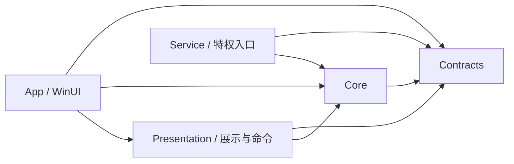

# 模块与依赖边界

适用本轮结构优化及 0.3.6 alpha。保持原命名空间，目录表达职责，程序集表达依赖方向。

| 项目 | 目录 | 归属 |
| --- | --- | --- |
| App | Shell / Pages / Infrastructure | 原生窗口与托盘、WinUI 控件、语言/平台接线；App.xaml/Program 保留入口 |
| Presentation | Commands / Settings / Endpoints / Panel / Shell / Interop | 可直接引用并测试的页面准入、提交草稿、端点编辑、展示投影、位置/退出策略和 Win32 声明；不引用 WinUI |
| Core | Runtime / Operations | 对外用例、生命周期事务、状态提交、退出资源保留、并发准入 |
| Core | Configurations / Yaml | 配置与订阅事务、候选校验、运行配置、共享 YAML 结构 |
| Core | Controller / Endpoints | REST/WebSocket、只读采集、会话代际、目录/凭据/传输 |
| Core | Networking / Settings | 监听与代理所有权、恢复；设置草稿/持久化/journal/提交 |
| Core | CoreManagement / ServiceClient / Windows / Infrastructure / Presentation | 核心文件/进程/更新、窄 IPC、真实 OS 能力、原子文件/有界集合、无 WinUI 的列表/节流策略 |
| Core | NetworkSwitching | 已有网络切换源码；生产未创建 SSID 观察源，入口继续隐藏 |
| Service | Hosting / Dispatch / Updates / Tun | 服务/管道、请求台账与统一串行化、核心更新事务、TUN 事务 |
| Contracts | Models / Snapshots / Service | 稳定状态/数据、展示快照、协议 3 与 IPC 载荷 |

`ArchitectureBoundaryTests` 验证项目引用方向、Core/Contracts/Presentation 不引用 App/Service/WinUI，以及生产不包含 Owned fixture 观察源或隐式路径兼容构造。`ServiceArchitectureTests` 禁止服务引用 App/Presentation 和桌面订阅、设置编辑、端点目录等用例。

Service 对 Core 的 friend 访问目前保留：生命周期确认和实际监听策略使用内部类型，共享它们无需公开整个基础设施 API。下面是当前服务源码引用的 Core 类型清单（Contracts 不计入）：

| 边界 | Core 类型 |
| --- | --- |
| 路径、更新、进程 | AppPaths、CorePathPolicy、CoreUpdateManifest、CoreUpdater、ManagedCoreVerifier、ManagedCoreOwnershipException、MihomoProcessManager、LocalCoreProcessIdentity |
| 启动、监听、绑定 | CoreStartupReadiness、CoreStartupObservations、CoreStartupTarget、CoreStartFailure、ControllerPortAllocator、ControllerPortAllocationResult、ListenerOwnerObservation、ListenerOwnerObservationScope、ListenerReadinessCancelledException、LocalPortBinding、MihomoEffectiveListenerPlan、MihomoListenerPlanAnalyzer、MihomoListenerPorts、PortPlanConflict、PortTransport、RuntimeBindingValidator、WindowsListenerOwnerTable |
| 控制器、配置、TUN | MihomoApiClient、MihomoDataParser、MihomoStreamException、EndpointTransportPolicy、RuntimeConfigBuilder、MihomoTunConfiguration |
| 准入、IPC、恢复 | BooleanSingleFlight、OperationBusyException、ServiceCommandException、ServicePipeClient、SystemProxyRecovery、ErrorSanitizer |

新增跨模块使用需要在对应事务中说明所有权、期限与代际判定；上述清单是维护入口，不替代服务自己的路径、ACL、协议及允许命令校验。Runtime 仍承担服务接管、轮询与最终用例编排，这些事务跨越多个事实来源，本轮没有为压低行数继续拆分。

WinUI XAML 位于 Pages/Shell 后，其 XBF 也保留相对目录。EXE 发布补拷贝生成资源时递归复制 XBF/PRI 并保留相对路径。Release 排除 Shell/MainWindow.SmokeTest.cs；Debug smoke 验证实际生成组件接线。
